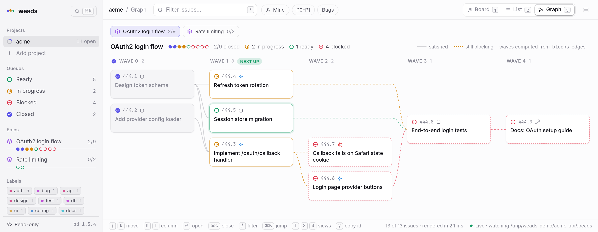

<p align="center">
  
</p>

<h1 align="center">weads</h1>

<p align="center">A fast, read-only web UI for projects that use the <a href="https://github.com/steveyegge/beads">beads</a> graph issue tracker.</p>

---

<p align="center">
  
</p>

weads shows the issues of one or more beads projects in your browser. It reads
each project through the `bd` CLI and never writes to it. When an agent or a
person changes a store, open pages update live.

## Features

- Board, list, and dependency graph views, with a detail panel for each issue.
- Filters, a command palette, keyboard control, and shareable URLs.
- Live updates over server-sent events, without polling `bd`.
- Many projects in one window. Add them from the UI, the command line, or `.env`.
- One executable with the UI embedded. It listens on localhost only.

## Requirements

- Go 1.27 or later, to build.
- [`bd`](https://github.com/steveyegge/beads) on your `PATH`, or pass `-bd`.

## Usage

```sh
make build
./weads ~/work/my-project
```

Then open <http://127.0.0.1:7707>.

| Flag      | Default                 | Meaning                    |
|-----------|-------------------------|----------------------------|
| `-addr`   | `127.0.0.1:7707`        | Listen address             |
| `-config` | `<user config>/weads/projects.json` | Project registry file |
| `-bd`     | `bd`                    | `bd` executable            |

A `.env` file in the current directory fills in unset environment variables:

```sh
WEADS_WORK_DIR=~/work                 # scans each top-level folder inside this folder that uses beads, or alternatively:
WEADS_PROJECTS=~/a/proj1,~/b/proj2    # add these folders manually
```

## Docker

```sh
docker build -t weads --build-arg UID=$(id -u) --build-arg GID=$(id -g) .
docker run --rm --network host -v weads:/data -v "$HOME/.local/bin:/bd:ro" weads
```

The image does not include `bd`. Mount the folder that holds your `bd` at `/bd`.

The container must run as the owner of your project folders, because `bd`
rewrites files under `.beads/` even when it only reads. `UID` and `GID`
default to `1000`.

## License

[GNU Affero General Public License v3.0](LICENSE).
